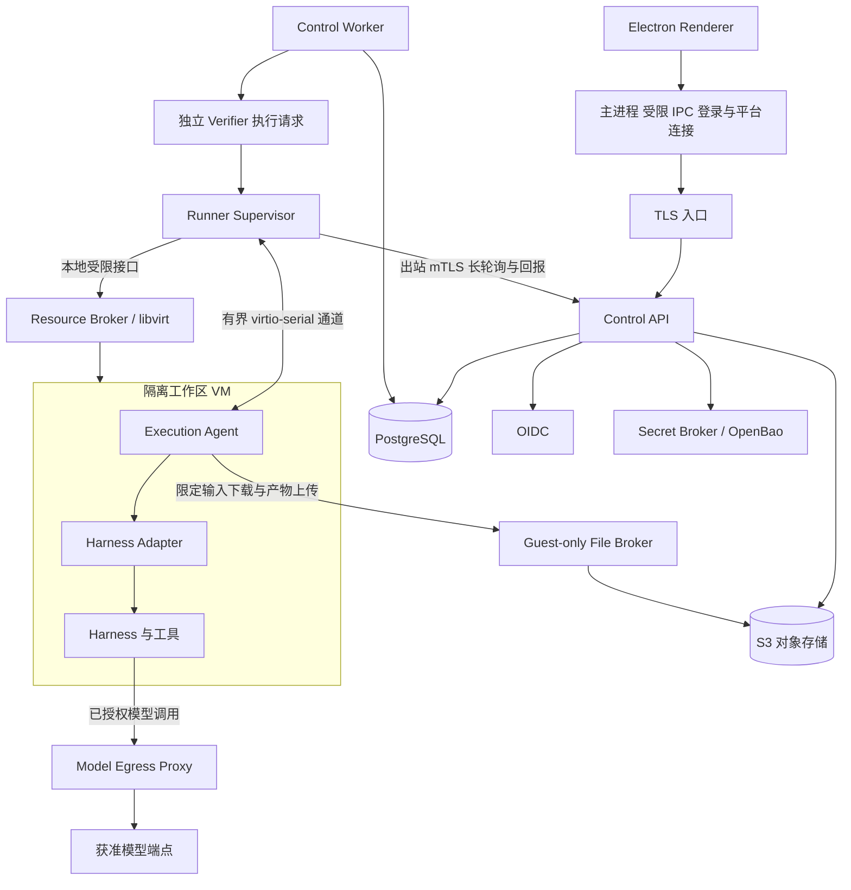
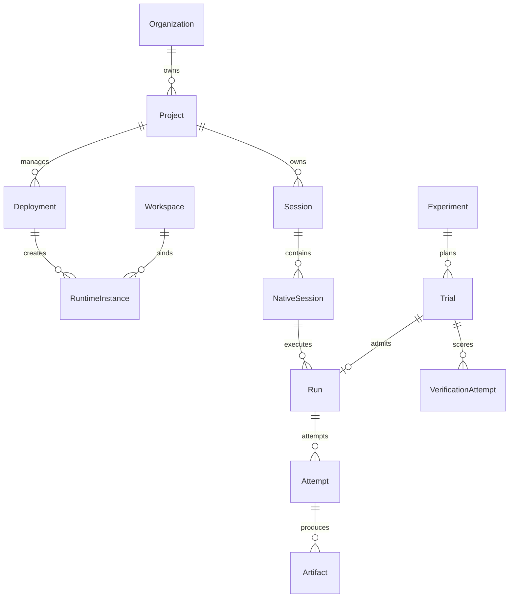
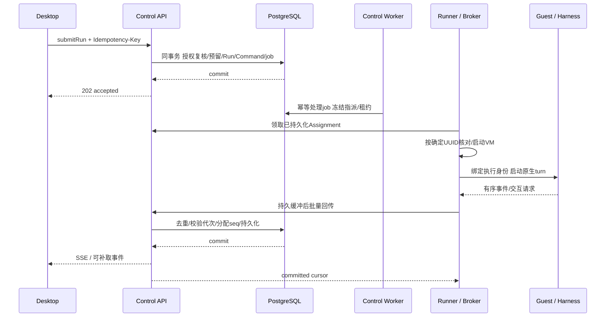

# Harniqo 技术架构

版本：1.0 · 2026-10-29 · 适用：macOS/Windows/Linux 客户端、Linux 执行面、团队私有部署与多租户 SaaS。

这是后续实现的架构基线，补充 [ROADMAP](../planning/ROADMAP.md)、[任务清单](../planning/BACKLOG.md) 和 [验收手册](../planning/ACCEPTANCE.md)。本文记录设计形成时的架构基线；后续依赖、原生 Harness 与真实 VM 的实测进展见 [M0 证据索引](../planning/M0-RESULTS.md)，性能与生产能力按各自用例单独验收。M0 的真实准入验证通过后冻结接口 Schema，M1 锁定补丁版本与依赖，不能把本文中的目标当成已测能力。

## 1. 总体决策

采用三层结构：薄桌面客户端、模块化单体控制面、独立执行面。控制面拥有业务状态；Runner 管理资源；VM 内的执行代理连接原生 Harness。客户端退出、断网或升级不决定云端任务的生死。

| 位置 | 选型基线 | 决策理由与实施约束 |
| --- | --- | --- |
| 桌面 | Electron + React + TypeScript + Vite | 共享 Chromium 行为，便于三端流式工作台和受限预览；当前可选受支持的 Electron45，实施时重新核对支持窗口并固定版本 |
| 客户端状态 | TanStack Query 管服务端缓存，局部 React 状态管界面 | 数据真值在控制面；不建立第二套可写业务状态，也不在本机运行一套云端 Harness |
| 服务端 | Node.js24 LTS、TypeScript、Fastify5 | 成熟的同语言工程；Node24 当前在 Maintenance，支持至 2028-04-30，必须在 EOL 前验收升级；Electron 内置 Node 独立管理 |
| 契约 | JSON Schema draft2020-12 + Ajv2020 + 类型生成 + OpenAPI3.1 | 一份 Schema 校验/生成客户端类型及文档；Python 执行器读取同一格式，显式配置方言，不依赖 Fastify 默认 Draft7 |
| 数据 | PostgreSQL17、Kysely + pg | 显式 SQL、事务、复合外键与 RLS；迁移与运行角色分开；不通过自动同步表结构部署 |
| 队列 | pg-boss12，与业务同一 PostgreSQL | 业务接受和 job 登记使用官方事务 Adapter、同连接同事务；至少一次交付，通过状态核对和幂等执行处理重复 |
| 对象 | S3 协议；私有默认 SeaweedFS 社区版，可接已验收客户 S3 | 输入、产物、大轨迹和报告；只依赖通过测试的协议子集，备份包括对象数据及元数据 |
| 身份 | 标准 OIDC；私有默认 Keycloak，也可接企业 issuer | 系统浏览器 + PKCE；认证与组织/项目授权分开，私有版不依赖官方云身份服务 |
| Secret | 私有默认 OpenBao；平台保留 Secret 引用 | 长期密钥与执行授权分离；需要初始化、unseal、ACL、轮换及独立恢复方案 |
| 执行 | Linux + KVM/QEMU + libvirt，首版一个执行后端 | 工作区/Trial 强隔离；Harness 容器在 VM 内；不建设自有 VMM，也不预先实现多云调度抽象 |
| Runner 缓冲 | 有限容量 SQLite WAL 本地 spool | 只保存待确认命令/事件及资源身份，不替代 PostgreSQL 业务真值；绑定库与持久性配置在 M1/M2 验收 |
| 评测 | Python 集成进程 + 一个主执行器 + 独立 Verifier VM | 复用平台的 Run/Attempt/配额/资源调度，不另建一套任务生命周期 |
| 运行观测 | OpenTelemetry、结构化日志、Prometheus 指标 | 可接客户现有后端；独立部署提供观测配置。日志不默认记录完整 prompt、密钥或业务文件 |

版本、许可和官方事实见 [技术栈核验](../../research/architecture-stack-verification.md)。Node24/PG17 是受支持基线，不是“当前最新 major”的声明；新 LTS/依赖升级通过兼容测试后调整。项目 MIT 不改变 Keycloak、OpenBao、SeaweedFS 或各 Harness 的许可。

首版不要求 Redis、Kafka、Kubernetes 或 Temporal。增加它们必须有可测量的容量、恢复或部署需求，不能让生产基础语义依赖未来替换。

## 2. 进程、网络与信任关系



图中的 Broker 是职责与权限划分，不要求全部成为独立网络微服务。Control API 和 Control Worker 来自同一模块化代码与发行物，使用不同进程角色扩容；文件代理与模型代理可以先作为独立监听/权限域的控制面进程角色。Runner 安装包包含普通权限 Supervisor 和最小化的本地 Resource Broker。

- **桌面主进程**持有平台访问凭据、处理系统浏览器回调和云连接；renderer 只拿视图与受限操作，不持有刷新凭据、供应商密钥或 Runner 管理身份。
- **控制面**拥有租户、命令、状态、审批、配额和实验；不启动用户 shell、加载不可信插件或挂载 Agent 可写磁盘。
- **Supervisor**主动领取任务、维护资源映射、缓冲事件和对账；不需要直接访问数据库，也不向 guest 提供通用宿主命令接口。
- **Resource Broker**通过 libvirt 管 VM，只接受固定镜像模板、已授权实例 ID 和受限资源参数；拒绝用户提供的 XML、QEMU 参数及宿主路径。用本地 ACL/polkit 缩小权限，不把完整管理 socket 交给 guest。[libvirt ACL](https://libvirt.org/acl.html)
- **Execution Agent**在 VM 内运行 Adapter，连接该 VM 内的 stdio/HTTP/WS Harness。平台控制消息通过专用 virtio-serial；消息有长度限制和 Schema，不提供“执行任意宿主命令”。Guest 的状态报告是待核对事实，不能证明宿主已停机。
- **外部服务连接**的 Adapter 在独立、无虚拟机管理权限的 Connector 执行身份中运行，限定组织、项目、目标地址和 Secret。外部服务是否可共享，依据实际信任域和上游授权验证。

Guest 默认无通往管理网、云 metadata、其他 VM、数据库、OpenBao 或内部存储管理接口的通路。只有声明的模型/工具出口、限定的产物上传入口等可达；域名检查同时约束解析后地址与重定向，防止转入内部地址。所有例外进入运行配置和实验清单。

Guest-only 文件入口只允许读取本执行的冻结输入、上传本执行的产物，不提供对象列表、任意 key 或通用代理。模型/文件/工具入口使用独立 execution audience 与 scope；可以同发行物交付，但 guest 不能通过这些入口进入普通 Control API、身份或存储管理路径。

## 3. 七个业务 Module

Module 的 Interface 包括类型、权限、顺序、错误与持久性约束。对外只暴露下表的领域操作，内部表和队列结构不能成为调用者依赖。

| Module | 持有的数据与复杂度 | 主要 Interface |
| --- | --- | --- |
| Access | 外部身份、组织/项目成员、角色、授权版本、执行身份 | `authorize(scope, action, resource)`、身份/成员管理；每次调用重新确认资源归属 |
| Runtime Management | Harness/Adapter 发行包、能力证据、配置修订、部署、目标、运行实例 | `publishConfiguration`、`reconcileDeployment`、`resolveCapabilities`；配置修订不可变 |
| Execution | 工作区、Session/NativeSession、Run/Attempt、租约、事件、审批/澄清 | `submitRun`、`requestStop`、`respondInteraction`、`readSnapshot`、`readEvents`；隐藏重复交付、原生身份和恢复差异 |
| Assets | 输入快照、上传、对象校验、产物、下载与保留 | `prepareUpload`、`commitUpload`、`publishArtifact`、`authorizeDownload`；对象就绪后才对用户发布 |
| Evaluation | 任务集、Manifest、候选、Trial、Verifier/评分、报告 | `planExperiment`、`startExperiment`、`requestVerification`、`readReport`；Agent Run 与评分结果分开 |
| Usage | 预算、预留、用量、价格版本、结算调整和配额 | `reserve`、`recordUsage`、`settle`；并发限额及资金更新在事务内核对 |
| Audit | 授权/配置/审批/运维操作记录与导出 | `append`、授权查询/导出；应用账号不能修改已写入记录 |

Execution 的接受事务协调 Access 检查、Usage 预留、Run/Command 创建及队列登记。模块内部可以拆分函数、仓储和测试 seam，但不为每个类创建 provider/factory，也不让 HTTP handler 跨模块任意写表。

Harness Adapter 是有真实差异的 seam；至少三个原生协议需要不同 Adapter。首版 libvirt 后端先作为具体 Module 实现，不预制尚未落地的云厂商插件。Kysely/pg/S3 SDK 留在 Implementation 内，UI 不知道它们的实体类型。

## 4. 领域关系与数据归属



Deployment 固定版本、配置修订和执行目标；RuntimeInstance 持有实际 VM/服务身份与工作区归属。不能把“同一个部署配置”实现成所有租户共用一个有任意文件权限的进程。

Trial 是计划单位，不兼容或未获准的 Trial 可以没有 Run。获得准入后，一个 Trial 关联一个逻辑 Agent Run；基础设施重试只增加该 Run 的 Attempt。Attempt 始终归 Run，避免 Run 和 Trial 分别调度同一次执行。原生会话可在准入/启动时建立；排队阶段允许 Run 的 native binding 尚未确定，执行前必须冻结并验证。

| 数据组 | 主要记录 | 必须保证的约束 |
| --- | --- | --- |
| 身份 | principals、external_identities、organizations、memberships、projects、project_memberships | 外部身份唯一 `(issuer, subject)`；email 不能作为稳定主键；成员撤权有版本与审计 |
| 目录 | harness_releases、adapter_releases、capability_evidence | 发行包不可变；能力记录包含版本、模式、证据和限制；全局目录与租户配置分开 |
| 配置/部署 | configuration_revisions、secret_references、deployments、deployment_revisions、execution_targets | 配置冻结；目标归属和项目授权明确；升级产生修订而不改旧 Run 的配置 |
| 实例/工作区 | runtime_instances、workspaces、workspace_leases、runner_registrations | 实例 UUID 确定；同一工作区至多一个有效写者；记录代次、资源上限和真实状态 |
| 执行 | sessions、native_sessions、runs、attempts、commands | 原生 ID 按实际 issuer/工作区/实例代次定命名域；命令幂等唯一；一个 Attempt 只有一个有效执行身份 |
| 事件/交互 | run_events、approvals、input_requests | `(run_id, seq)` 唯一；来源事件去重；审批绑定 Attempt、参数摘要、权限版本与 TTL |
| 文件 | file_objects、uploads、input_snapshots、artifacts | 平台生成对象 key；内容 hash；状态与归属；对象存在且校验后才 ready |
| 实验 | dataset_versions、task_definitions、experiment_manifests、candidates、trials | Manifest 不可变；Trial 唯一 `(experiment_id, task_id, candidate_id, repetition_index)` |
| 评分 | verification_attempts、score_results | 关联 Trial、Agent Attempt、产物 hash、Verifier/rubric/model 版本；评分失败不改写 Agent 运行终态 |
| 计量 | usage_records、budget_reservations、usage_adjustments | 来源去重；金额用十进制定点及币种，JSON 以字符串表示；未知不写成零；调整追加记录 |

租户表必须有 `organization_id`，项目资源另有 `project_id`。项目、会话、运行、文件和配置之间使用带归属的复合 FK/UNIQUE，阻止跨组织/项目误关联。当前状态在业务表，事件用于过程与审计；本方案不是把所有业务改成事件溯源。[PostgreSQL 约束](https://www.postgresql.org/docs/17/ddl-constraints.html)

## 5. 授权与 RLS

API 验证 Access Token 的 issuer、audience、签名与有效期；ID Token 不能代替 API Access Token。登录只确定 principal，组织/项目权限由数据库里的成员关系和受控映射决定。

所有请求和后台任务先经 Access，再进入带组织上下文的显式数据库事务。事务封装设置 `set_config('app.organization_id', value, true)` 和 principal 上下文；缺少上下文默认拒绝。连接归还后不能把上个租户的上下文留给下次请求。

运行账号非表 owner、非 superuser、`NOBYPASSRLS`；迁移账号单独保存。租户表启用并强制 RLS，读写分别有 `USING`/`WITH CHECK`；应用仍逐项检查项目与动作权限。跨租户调度索引只保存最少资源 ID，调度器不能因此获得任意租户内容的直接读写接口。pg-boss schema 只对获准生产者/消费者开放，DDL 由部署迁移执行。

RLS 防止误用查询导致跨租户读写，不代表可以接受任意 SQL。参数化查询、受控事务入口和执行身份隔离仍是必要条件。[RLS 语义](https://www.postgresql.org/docs/17/ddl-rowsecurity.html)、[事务局部配置](https://www.postgresql.org/docs/17/functions-admin.html)

撤权后，重放旧幂等请求也必须先重新授权，不能直接返回过去有权限时的结果。已接受 Run 归组织所有；移除提交者不会使组织管理员失去管理能力。是否同时停止 Run 由组织策略决定，不能因为用户退出客户端而隐式取消。

## 6. 接口与协议

### 客户端到平台

HTTPS JSON 命令/查询 + SSE 事件。默认 REST/OpenAPI；不通过 MCP、ACP 或 WebSocket 通用消息替代平台管理契约。桌面主进程通过支持 Authorization header 的流客户端读取 SSE，向 renderer 发经过校验的事件。

| Interface 类别 | 计划路径示例 | 关键约束 |
| --- | --- | --- |
| 版本与环境 | `GET /v1/meta` | 平台/契约版本、最低客户端、支持窗口、功能范围；不兼容时停止写操作 |
| 资源管理 | `/v1/organizations/{org}/projects/{project}/...` | 路径 scope 不是授权证明，必须与数据库归属和成员权限一致 |
| 目录/部署 | `.../harness-releases`、`.../deployments`、`.../configuration-revisions` | 区分外部连接与托管；能力按版本；发布配置不可变 |
| 提交执行 | `POST .../sessions/{session}/runs` | `Idempotency-Key`、配置修订、输入快照、预算策略；接受返回 202、run/command ID |
| 状态与历史 | `GET .../runs/{run}`、`GET .../runs/{run}/events?after=...` | 快照和历史可单独查询；SSE 不是唯一恢复入口 |
| 取消/交互 | `POST .../runs/{run}/stop`、`POST .../approvals/{id}/responses`、`.../input-requests/{id}/responses` | 接受取消不等于停止成功；交互响应绑定内容、身份、Attempt 和有效期 |
| 文件 | `.../uploads`、`.../uploads/{id}/complete`、`GET .../artifacts/{id}/content` | 上传/完成分开；下载代理重新授权，支持受控 Range；不暴露内部对象长期直链 |
| 实验 | `.../dataset-versions`、`.../experiments:plan`、`.../experiments`、`.../trials`、`.../reports` | 创建前预检数量/兼容/预算，启动后 Manifest 不可变 |

路径为 Interface 设计，最终 OpenAPI 在 M0-02 固定；不能把这些示例误认为现有可调用接口。错误体统一包含稳定 `code`、`request_id`、可重试类别和安全的具体说明。至少区分 `FORBIDDEN`、`CAPABILITY_UNSUPPORTED`、`VERSION_INCOMPATIBLE`、`IDEMPOTENCY_CONFLICT`、`BUDGET_EXCEEDED`、`CURSOR_EXPIRED`、`EXECUTION_UNCERTAIN`。自动重试只适用于被明确标记的幂等网络操作。

### Runner 到平台

独立 `/runner/v1` Interface，出站 mTLS 长轮询领取授权指派、续约、批量回传和核对资源；Runner 无 PostgreSQL 凭据。注册令牌一次性、短有效期；证书可轮换/撤销，绑定具体 target/pool。

每个 Assignment 固定 org/project、Run/Attempt、Workspace、RuntimeInstance UUID、image digest、配置 hash、租约代次、资源/网络策略和执行凭证范围。既有服务连接也有独立作用范围，不能接受客户端任意地址与管理员密钥直接转发。

## 7. 一次运行怎样执行



业务接受事务包括预算预留、Run/Command、首条事件和 pg-boss job；采用其官方 Kysely 事务 Adapter，同数据库连接提交。这里没有需要额外维护的一套内存消息总线。若集成无法证明同事务语义，M1 验收失败，不能以“最终会投递”代替原子接受。[pg-boss 事务 Adapter](https://pgboss.io/api/adapters)

job 只触发对持久状态的协调，不直接等于“再运行一次 Agent”。消费者在事务里核对 Run、预算和工作区，建立唯一指派；重复 job 观察同一指派并返回。队列 ACK 表示这段协调已持久完成，不能一直拿 job 锁来代表数小时 Agent 的执行权。

启动前固定 VM UUID。libvirt 调用超时先查询这个 UUID，禁止另造 UUID 再启动。工作区租约代次递增，写状态/接受交互必须核对最新代次；旧代次的真实费用仍进入审计与结算。执行租约不替代资源事实。

Resource Broker 独立于 Supervisor 持久保存并检查权威截止时间，约束时钟偏差，不使用 guest 时钟。无有效续约时撤销出口并停止 VM；Broker 重启先核对已有资源，禁止没有有效 Assignment/Grant 的 VM 自动启动。宿主故障导致无法确认停止时，平台不能只凭截止时间就启动第二写者。

## 8. 持久事件、状态与恢复

来源事件去重键为 `(attempt_id, stream_id, source_seq)`。控制面在 Run 行锁下分配递增 `seq`，事件、业务状态及 seq 同事务提交，提交后才推送/确认。单 Run 的游标反映该 Run 的提交顺序，不能用全局 BIGSERIAL 推导所有事务的提交顺序。[序列语义](https://www.postgresql.org/docs/17/functions-sequence.html)

Runner spool 有配额、落盘确认和重传游标；guest 的 critical event 在控制面 committed ACK 前保留。Runner “已接收”与控制面“已提交”不是同一种 ACK。SQLite spool 使用本地文件系统、WAL + FULL 同步及有界 checkpoint，核验实际嵌入的 SQLite 已修复 WAL-reset 问题（3.51.3+ 或官方已修复分支）；不放在网络共享文件系统。大轨迹分块进入对象存储并校验后才发布引用。缓冲耗尽必须限流、暂停或停止执行并显示原因，不静默丢审批/终态事件。[SQLite WAL](https://www.sqlite.org/wal.html)

原始console字节独立交给[有界console Module](../../apps/runner/CONSOLE.md)：可信宿主
写者先实际预留固定容量，逐次同步，容量/I/O失败锁存并交回已绑定资源的撤销流程。
原始前缀与归档的长度/摘要/身份分别核对，失败日志不能标完整。该Module没有事件
ACK、重传或崩溃续接语义，不替代上述SQLite spool；通用文件系统quota和其他宿主
日志仍需各自准入。

committed ACK 按 `(attempt_id, stream_id)` 返回最高连续提交的 `source_seq`，不能以最大序号跨过缺口。乱序事件保留、缺口重传，Runner/guest 只删除已确认范围；原始块需对象校验及数据库引用均完成后确认。物理宿主损坏导致未提交尾部确实无法恢复时，明确标注轨迹不完整，不伪造连续历史。

SSE 用 `id`/`Last-Event-ID` 携带游标，持久数据仍来自数据库；NOTIFY 仅唤醒读取。任务中心先使用授权快照、ETag 和低频刷新，不共享一个可能漏提交的全局文本流游标。游标过期返回 `CURSOR_EXPIRED`；`readSnapshot` 在同一数据库一致性快照中返回 projection 和 `last_seq`，客户端从该 seq 补取并跟随，不能先读快照再取一个更晚游标。订阅建立和历史补取交叠时靠事件 ID 去重，并定期按 cursor 查持久记录，不因通知丢失漏事件。[SSE 规范](https://html.spec.whatwg.org/multipage/server-sent-events.html)

状态沿用 `accepted/queued/provisioning/running/waiting_approval/waiting_input/stopping/reconciling/succeeded/failed/cancelled`。`succeeded` 只表示 Agent 执行生命周期完成，不表示业务评分成功；评分保存在独立记录。

| 故障/操作 | 平台处理 | 禁止的推断 |
| --- | --- | --- |
| 桌面断线/退出 | 云执行按策略继续，重新登录授权后补取 | 订阅消失不代表取消 |
| API/Worker 重启 | 从 PostgreSQL 和实际资源重建协调，job 可重投 | 不能因消息重投创建第二个写者 |
| Runner 失联/租约过期 | 进入 reconciling；本地 Broker 依据已验证租约截止策略撤销出口/停机；控制面核对宿主 | fencing 只拒绝旧写入，不证明旧执行已停 |
| VM 崩溃 | 核对磁盘与原生持久状态；可续接才恢复，否则标失败/人工决策新 Attempt | 不把导出的文本轨迹当原生断点 |
| 原生 Session 恢复到新实例 | 验证恢复能力并记录新的绑定事件和代次 | 相同 native ID 不自动证明同一连续上下文 |
| 取消 | stopping → 原生 abort/撤销后续模型工具授权 → 实际资源停止证明 → cancelled | Guest ACK、关闭连接、失联不能证明已停止 |

对不可信 VM，取消的正式停止证据来自宿主的 libvirt/QEMU 状态；无法可靠确认任务组终止时停整个 VM，保留工作区磁盘。宿主不可达则保持 reconciling，不能允许另一个实例写同一工作区。远端已有服务若只能回“收到取消”而无终止证据，应声明较弱能力，不能进入要求强停止保证的工作流。

已提交的外部操作和在途模型请求可能继续产生副作用/费用。取消阻止后续调用，结算等待真实证据，不能立即释放全部预留。

## 9. 工作区、镜像与 VM

同一获准交互工作区保留磁盘、HOME、原生状态，连续 Run 串行进入同一工作区；空闲 VM 按策略回收，磁盘和原生会话按保留策略保存。不同组织、未授权工作区、Trial 和并行候选分别使用独立写入层；同一镜像的只读层可复用。

所有容器归档、VM base 与写入层位于工作区根目录的 `images/`；指定服务器的绝对目录仍以私有环境记录为准。镜像构建脚本、来源、digest、归档 SHA-256、依赖锁和 SBOM 可追溯，详见 [镜像规范](../../images/README.md)。运行状态单独放 `.state/`，不进入 Git。

- 默认 guest 使用经过验收的 Linux 基础镜像与独立 Harness 运行包；Python/Node 等依赖在该运行包内固定，不能因控制面 Node 版本而假设所有 Harness 兼容。
- Resource Broker 只接收允许模板；验证镜像真实路径、backing chain、ACL/AppArmor、可用空间、磁盘配额和 QEMU 宿主资源上限。不能为方便读 `images/` 而关闭 libvirt 的保护。
- 不向 guest 传任意宿主目录、管理 socket 或共享可写 HOME。宿主不挂载、解析不可信磁盘来取文件；产物经受限上传，特殊格式在隔离预览/评分环境处理。
- 基础快照区分 application/filesystem/crash-consistent。默认恢复磁盘和原生持久状态；不承诺用内存快照恢复任意 Harness/网络连接。运行中快照须明确一致性，不能把云盘快照当应用一致备份。[libvirt 快照](https://libvirt.org/formatsnapshot.html)
- KVM 权限、受支持机器类型及实际启动是 M0 准入；不得在不足时悄悄改成 TCG 仍声明同样支持。[QEMU 安全模型](https://www.qemu.org/docs/master/system/security.html)

用户代码或任意 Dockerfile 的镜像构建也属于不可信执行，使用独立构建 VM，不把系统 Docker socket 交给构建任务。首版目录仅发布经过准入的运行包，不把任意 npm/pip 安装变成控制面全局插件。

## 10. Harness Adapter Interface

Adapter 位于执行代理内部，保留原生提示词、工具和会话机制。平台只归一化管理与展示所需事件；原始事件另存，不能为了统一 UI 把所有 Harness 变成同一套 Agent 循环。

Interface 的核心操作是：

1. `describe(release)`：返回版本、能力、限制、配置 Schema 与证据。
2. `attach(context, nativeSessionRef?)`：创建或接入一个获准原生会话，返回带命名域的身份和恢复类型。
3. Session handle 的 `start(input, attempt)`、`observe(cursor)`、`respond(interaction, decision)`、`requestStop(execution)`、`inspect()`：驱动原生 turn、事件、人工交互与停止/核对。

这些是设计签名；实际类型在 contracts 固定。Context 只含本次获准配置、工作区和短期凭证，不含平台管理员身份。Adapter 不自行决定组织权限、预算或宿主资源；文件产物由 Assets 的受限 Interface 发布。

能力不仅是 boolean，还包含适用版本、接入模式、限制与证据：例如停止保证、网络重订阅、历史恢复、原生续接、崩溃断点、审批、澄清、文件、分支、模型/用量。未知与不支持分别表示，要求缺失能力的任务在启动前拒绝。

ACP 只是部分 Adapter 的底层协议；MCP 提供工具/资源，A2A 提供协作，OTel 提供遥测，都不替代平台的授权、会话、持久化或部署。Octop 原生服务、Octop Harness、Octop 委派外部 Harness 分开登记，不合并原生身份、模型、外层调用和费用。

审批分两层：原生审批表示 Harness 的协作暂停；需要阻止恶意代码产生外部操作时，真正拥有凭据的工具 Broker/出口策略也必须验证授权。不能只靠一个审批弹窗就宣称任意代码无法绕过。

## 11. 文件、Secret 与模型出口

### 文件发布

对象状态为 uploading → 校验 → ready，失败进入 quarantined 或待回收。对象存储和 PostgreSQL 无共同事务：先验证对象实际存在及 hash，再在事务中发布 Artifact；失败通过对账回收孤儿对象。输入是内容冻结快照，不指向会随本机文件修改而变化的路径。

下载走授权代理，每个新请求与 Range 续传重新检查；活动传输按撤权传播时限终止。内部签名 URL 不暴露给用户，避免绕过撤权。已经下载到用户磁盘的内容无法撤回，不作相反承诺。

### Secret 与出口

Secret 长期值留在 OpenBao，数据库存引用/版本。Runner 管理凭据、执行凭据、供应商密钥和用户登录凭据不能相互替代。执行身份只获得本次必需 Secret 的临时授权；平台 root/unseal 密钥不进入运行包、镜像、日志或 guest。

能配置兼容端点的 Harness 优先经 Model Egress Proxy：guest 使用绑定 Workspace、RuntimeInstance、Attempt、租约代次和 scope 的短期凭证；模型/工具 Broker 与产物写入口在每个新操作时核对当前授权、执行状态、撤销和代次，再校验模型/端点/预算。只验证 JWT 未过期不足以阻止旧 VM 新调用。在途请求和旧代次真实消耗仍保留结算证据。代理使用供应商凭据转发原生请求，保持协议和参数，明确记录任何转换；不将所有模型强改成单一最小接口。需要长期 Secret 的原生工具也按最小 scope 发放，不能保证 VM 内受授权代码无法读取其自身获准凭据。

不兼容代理的 direct BYOK 模式单独准入：用量精度、外部配额、时长/步数和可终止性明确展示，不能承诺不可观测费用的精确硬封顶。首版使用正式 API 凭据，不把个人订阅登录默认当作可商业托管的模型池。

## 12. 计量与预算

提交执行时锁定组织/项目预算和并发，建立唯一预留；重复命令不重复预留。代理请求先预留本次请求可能的消耗，再接受供应商用量/价格版本结算。模型、VM、存储、评分、重试和人工干预分别归因。

用量记录附原生/供应商请求 ID、Attempt、来源、时间、单位、币种、价格版本及 actual/estimated/unknown。Run 完成不代表账单已最终结算，延迟使用量通过追加调整记录补齐。孤儿进程、失联 VM 或取消不能直接把预留释放为可用；只释放确认未消费的部分。

预算硬上限只在可完整拦截并可靠约束请求的范围内声明，预留考虑单次最大输出、并发、在途调用和延迟结算。其他渠道显示具体限制及误差，未知费用不算零。

## 13. 对比与批量评测

单任务对比和批量实验共用 ConfigurationSnapshot、Run、Attempt、Assets、Usage 与资源调度。不同的是实验先创建确定 Trial 集合，再逐项准入/执行；不会因一个候选失败阻塞其他结果。

Manifest 固定任务集/输入 hash、候选、原生 Harness/Adapter/网关、模型/端点/参数、工具/skills/MCP、记忆初始状态、镜像、资源、网络、审批、预算、超时、重复序号与评分版本。运行中更改任何配置产生新实验，不覆盖旧结果。

Verifier 使用另一台隔离 VM，只得到冻结评分材料和只读候选产物；Candidate 无法修改隐藏测试、奖励文件或评分身份。评分错误单列，LLM Judge 不覆盖客观失败；其 rubric、模型与抽样人审证据保存。

评分指派复用 Runner 的资源/租约机制，以类型化 owner reference 区分 Agent Attempt 和 Verification Attempt；凭证、预算、产物写入口绑定相应 owner，不复用候选的执行身份。Verification Attempt 是独立评分记录，不再创建一套与 Run 竞争同一工作区的 Agent 调度状态机。

主执行器在 Harbor/AgentCompass 中用相同真实小任务验证后择一，作为平台下面的执行集成；平台持有 Trial 身份和预算，防止外部执行器隐式重试绕过 Attempt 账本。

验收基线为 20 任务 × 3 候选 × 3 次重复 = 180 个计划 Trial。自然效果基线与故障注入实验分开；失败、取消、不兼容和未知均保留。报告同时列有效评分成功率、全部计划成功交付率、评分覆盖率、首次/最终结果、波动、人工干预与累计成本，口径沿用 [ACCEPTANCE](../planning/ACCEPTANCE.md)。

## 14. 部署配置

| 配置 | 实际拓扑与交付 | 适用的承诺 |
| --- | --- | --- |
| 开发/验收 | 指定服务器工作区；Compose 运行控制面依赖；本机 libvirt 验证 VM；三端原生 CI 独立 | 单机集成，不宣称 SaaS 隔离或高可用已通过 |
| 小型私有生产 | 客户控制节点/数据库/对象/身份/Secret；独立受控执行节点；安装包与备份在客户边界内 | 完整功能、可备份恢复；单节点故障窗口明确，模型/外部工具依赖声明 |
| SaaS 生产 | 至少两个 API 副本、独立 Worker、经验证 HA PostgreSQL/S3/身份/Secret、两台以上执行宿主和故障余量 | 不互信租户隔离、控制面可用性与执行对账分别验收；活动 VM 不因有备用节点就自动无损接管 |

Compose 是交付编排，不决定信任关系；私有版也可以多节点，SaaS 首版不必先引入 Kubernetes。客户要求高可用时必须落实相应数据库/对象/身份/Secret 冗余与演练，不用多副本 API 掩盖数据库单点。

SaaS 的 TLS/LB 入口也纳入冗余；各依赖标注故障域及 N−1 容量，多实例同一物理宿主不算节点故障冗余。剩余节点有容量不表示原活动 VM 或原生会话可无损接管。

可独立部署默认依赖的持久内容包括 PostgreSQL、SeaweedFS Volume/Filer 元数据与集群配置、Keycloak 数据库、OpenBao 存储与恢复材料、原生工作区和镜像清单。它们可以在同一数据库实例使用独立数据库/角色，不能共享超级用户身份。恢复先保证密钥与基础存储可解密可访问，再恢复业务及对象一致性、原生状态并核对在途资源。

平台灾备恢复生成新的恢复代次并轮换/撤销旧执行授权，Runner 受控重新绑定；先隔离旧控制面、核对或停止旧 VM，再开放写服务。数据库回滚出的旧租约序号不能重新赋予旧实例写入权，仍须确认旧写者停止后才可启动新写者。

应用、镜像、状态目录和监听端口都由部署配置指定。指定环境的新宿主端口范围和保留 SSH 端口见 `.private/development-environment.md`；启动前检查占用，仅入口对外公开，DB/存储/控制接口默认不映射。Guest 串行通道避免为每台 VM 开宿主 TCP 端口。

## 15. 三端、安全与版本策略

Electron 主进程通过窄 preload Interface 提供登录、选择文件、启动下载、通知与平台操作，检查 IPC sender、参数及 scope；禁止任意路径读写、任意 shell/URL 打开和 renderer Node。采用 CSP、导航/新窗口白名单、渲染 sandbox；HTML/办公产物在受限环境预览。[Electron 安全](https://www.electronjs.org/docs/latest/tutorial/security)

登录使用外部系统浏览器、PKCE/state/nonce，原生客户端不包含客户端机密；回调绑定当前登录事务与平台环境。[RFC8252](https://www.rfc-editor.org/rfc/rfc8252)

刷新凭据由主进程的凭据 Module 统一保管，按 Electron 最终版本使用受支持 API 并确认真实安全 provider。Linux keyring 缺失/弱 fallback 时仅内存登录，不用固定密码或明文来实现记住登录。业务对话默认不持久缓存到本机；环境设置与游标按用户权限保存，离线编辑/离线执行不属首版。[safeStorage](https://www.electronjs.org/docs/latest/api/safe-storage)

首批验收 OS 白名单已在 [验收基线](../operations/ACCEPTANCE-BASELINE.md) 收窄为 macOS26 arm64、macOS15 x64、Windows11 25H2 x64、Ubuntu24.04 LTS x64；原 macOS14+ 是兼容设想，不作为首发安全支持声明。M0 核实可用原生设备，任何没真实验收的组合不能写正式支持。macOS 签名/公证、Windows 签名与 Linux 包管理分别实施；Linux 不依赖 Electron 内置 autoUpdater。[更新边界](https://www.electronjs.org/docs/latest/api/auto-updater/)

客户端、平台、Runner、执行代理和 Adapter 各带 build ID/契约版本。新增字段保持兼容，未知非关键事件可保留并提示；状态语义或必选字段变化提升契约 major 并握手拒绝。新客户端保留受支持旧服务窗口。迁移采用先扩展再切换再收缩，收缩前确认旧版本不再使用；不可逆迁移回退恢复匹配数据备份。

## 16. 工程布局、验证与可观测

```text
apps/desktop/                main / preload / renderer
apps/control-plane/          api / worker / modules/{access,runtime,execution,assets,evaluation,usage,audit}
apps/runner/                 supervisor / resource-broker / spool / reconciliation
apps/execution-agent/        guest bridge / Harness session driver
packages/contracts/          JSON Schema、错误、事件、版本握手
packages/client/             HTTPS/SSE 客户端、游标恢复
packages/adapters/           Hermes/OpenClaw/OpenCode/Octop 原生 Adapter
services/evaluation/         Python task/verifier 集成
tests/acceptance/            真实依赖、故障、安全与三端验收
deploy/                     镜像构建、Compose、VM 模板、配置及迁移
images/                     镜像规范与被忽略的二进制/写入层
docs/adr/                   关键决策与取舍
```

contracts 不引用 UI、数据库或具体 Harness；客户端不导入 server 实现；Adapter 不导入 libvirt、平台管理和数据库模块。每个业务 Module 管自己的写入，必要的跨模块原子行为经显式应用事务协调。TypeScript/Python 的交界是版本化 JSON/产物，不能依赖彼此进程内对象。

M0 契约采用 draft2020-12，Fastify 默认验证链不能自动承担该方言。M1 显式使用 Ajv2020 编译同一 canonical Schema；响应先做相同方言的 DTO 校验再用原生 JSON 序列化，未验证兼容性前不交给默认 Draft7 serializer。107 项契约 shape 样例和生命周期表须在 Python/Node 两端一致通过，禁止删除 `$schema` 或静默降级方言来让测试变绿。[Ajv 方言](https://ajv.js.org/json-schema.html)、[Fastify 验证与序列化](https://fastify.dev/docs/latest/Reference/Validation-and-Serialization/)

CI 从 M1 就覆盖三个原生系统；模块逻辑、真实 PostgreSQL/S3/OIDC 集成、Adapter 契约、真实 VM 故障和核心原生流程分层验证。至少包含：连接池租户上下文、同事务 job 回滚、并发预算、低序号晚提交、旧租约回报、取消竞态、上传成功但数据库回滚、撤权后重放、恶意产物和评分隔离。

日志和 trace 关联 organization/project/run/attempt/runtime-instance，敏感内容默认脱敏。Prometheus 指标只用经过预算的有限标签，如进程角色、获准 Harness 类别、操作与错误类型；Run/Attempt/UUID/trace 不作指标标签，避免无限基数。关键指标包括队列等待、VM 启动、运行/审批时长、SSE 延迟、spool 深度、reconciling 数量、孤儿资源、预算预留/实耗/未结算、评分错误和跨租户拒绝。观测数据有保留、权限和导出策略。[指标标签建议](https://prometheus.io/docs/practices/naming/)

## 17. 初始验收目标与阶段映射

以下是用于组织测试的工程目标，尚未测量，M0-07 必须锁定负载、数据规模与资源条件。达不到时补齐实现/资源或明确调整目标后再发布，不以目标值直接宣传性能。

| 项目 | 初始目标 |
| --- | --- |
| 控制面负载 | 100 个授权 SSE 连接、8 个同时执行 VM slot；交互与评测有独立保留容量及公平排队 |
| slot 资源 | 初始 2 vCPU/4 GiB，每任务可调但先准入；宿主保留至少 25% 的 CPU/内存及磁盘余量，禁止无界超售 |
| 平台延迟 | 控制面普通元数据 API 服务端 p95 ≤300ms；持久事件到活跃客户端 p95 ≤1s；不含供应商生成耗时 |
| 恢复/撤权 | 1000 条事件重连补取目标 ≤5s；活动订阅/下载撤权传播 ≤5s；Run 不会因断网隐式重启 |
| 备份恢复 | 首版目标 RPO≤15min、RTO≤4h；在冻结的数据规模与实际完整恢复演练下验收 |
| SaaS 可用性 | 99.9% 控制面可用性设计目标；需要上述冗余、监控和统计证据；单机开发或私有单节点不继承该承诺 |

| 里程碑 | 本架构需要落实的部分 |
| --- | --- |
| M0 | 领域/Schema、真实能力、KVM 通道与权限、镜像/恢复、依赖及上述目标冻结 |
| M1 | 工程布局、三端 CI、OIDC/RLS/Secret、PostgreSQL 事务/队列、契约和观测 |
| M2 | Supervisor/Broker/Execution Agent、首个 Adapter、Run/Attempt、事件、取消、文件、预算 |
| M3 | 审批/澄清、原生续聊、下载/预览、任务中心和错误恢复 |
| M4 | RuntimeInstance 生命周期、其余 Adapter、Octop 分项、能力/配置/升级兼容 |
| M5–M6 | 冻结对比、Trial/Run 关系、独立 Verifier、Manifest、统计与用量对账 |
| M7–M8 | 双部署、真实 DR/隔离/容量、三端签名升级、许可证/来源与生产发布 |

关键取舍记录于 [ADR-0001](../adr/0001-modular-control-plane.md)、[ADR-0002](../adr/0002-isolated-execution.md)、[ADR-0003](../adr/0003-native-harness-adapters.md)。这些决定约束后续实现；具体版本、模型权限、原生签名资源与真实隔离验证仍按里程碑关闭。

固定本地Resource Broker现已提供显式 `sealed-raw8g-q35-limited-v2`：固定CPU/内存/swap进入签名配置，在 `ensure/observe/renew` 核验真实QEMU身份、全线程与有限控制组；`resource_limits(resource_id)`仅提供宿主私有读样本，不能选择PID/路径或任意配额。v1保留恢复兼容，已登记实例组不能原位换profile。[同源真实结果与范围](../../research/m0-host-resource-limits.md)仅覆盖sealed1GiB模板与CPU压力对照，M0-05整体仍未验收。


`apps/model-egress` 已实现可信宿主内部的受限 HTTPS 上游传输 Module，配置冻结后只接受 routeId 与精确方法/路径；内部承担 DNS 答案集策略、单地址固定拨号、原 Host/SNI/TLS、Secret 注入、背压/边界/期限/取消和脱敏收据。它没有面向 Guest 的监听入口，调用方仍须在发起每个操作前完成权威执行授权、撤销/代次核对及预算预留；不得直接把该 Module 暴露为 Guest 任意代理。不可取消的 DNS/Secret/异步响应头依赖在超时返回后仍占用内部许可直至真正结束；取消或断流不能证明供应商停止计费。[接口与证据](../../apps/model-egress/README.md)、[真实结果和来源](../../research/m0-egress-transport.md)仅确认此内部子项，完整 Model Egress 与 M0-05 未验收。
