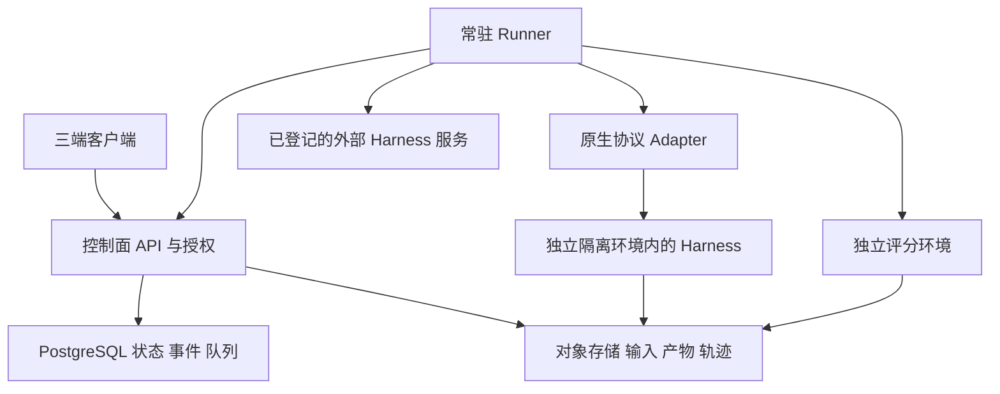
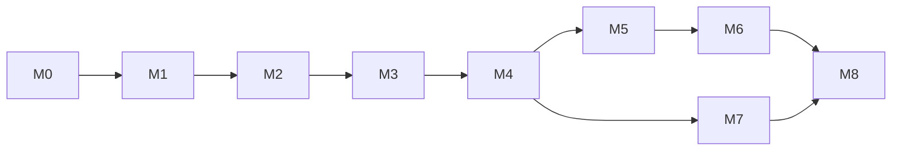

# Harniqo 开发方案与里程碑

版本：1.0 · 日期：2026-10-29 · 状态：开发计划已形成，应用尚未实现。正式仓库：[StateKnot/Harniqo](https://github.com/StateKnot/Harniqo)，MIT 许可证。

本文与 [BACKLOG](BACKLOG.md)、[ACCEPTANCE](ACCEPTANCE.md)、[GLOSSARY](../../GLOSSARY.md) 共同构成后续开发基线。正式开发与服务端验收使用指定的服务器工作区；确切目录、机器连接、资源和端口实测记录保存在不进入开源仓库的 `.private/development-environment.md`。本地副本便于阅读，开发开始后以服务器工作区和对应 Git 提交中的计划为准。

## 1. 交付目标

用户在三端客户端登录平台，创建项目，登记或部署 Harness，配置自己的模型端点、工具与权限，开始对话并处理审批，查看文件和执行状态。关闭客户端后云端按策略继续执行。用户可以对同一任务并排比较多个候选，进一步运行可复现的批量实验，并从报告回到原始过程和产物。

同一套领域模型、客户端、API 和运行包支持两种交付：团队在自有云独立部署；运营方提供多租户 SaaS。公开 SaaS 必须通过独立的隔离与运营验收，开发服务器连通或 Docker 能运行不能替代该验收。

### 首版必须交付

| 范围 | 可见功能与边界 |
| --- | --- |
| 三端客户端 | macOS、Windows、Linux；连接多个平台环境；组织与项目切换；会话、任务、产物、实验和设置 |
| 身份与协作 | OIDC 登录；组织、项目、成员和角色；每资源授权；邀请、撤权、审计；首版不做同一会话多人同时输入 |
| 部署管理 | 区分连接现有服务与平台托管；发行包和镜像版本、健康、资源限制、排空、升级与有条件回退 |
| 日常工作 | 新会话、持续对话、工具过程、审批、澄清、取消、断线重连、上传下载、安全预览、任务中心和通知 |
| 配置管理 | 模型端点与密钥引用、skills/MCP/工具配置、权限和记忆策略；保存并发布不可变运行配置 |
| 多 Harness | 至少 3 个通过正式准入的集成；Octop 服务与 Octop Harness 分开验证；不支持的能力明确展示 |
| 对比与评测 | 单任务并排对比；任务集与版本；矩阵、重复、预算、并发、独立评分、结果分析、导出与重跑 |
| 生产运营 | 计量与预算、租户隔离、执行对账、监控、备份恢复、配额、升级兼容、私有安装和三端发布 |
| 开源交付 | 可从干净环境构建、测试和部署；正式许可证、第三方声明、贡献与安全报告流程；示例不含真实业务数据 |

首版执行面正式支持 Linux。Windows/macOS 专用执行节点、无损跨 Harness 迁移、自动选优、复杂工作流画布、插件交易市场、移动端和大规模训练不进入首版。切换 Harness 通过新建原生会话并显式传递任务、摘要与文件；不宣称隐藏上下文或长期记忆无损转移。

## 2. 工程基线

### 技术选择与模块职责

| 模块 | 基线方案 | 持有的职责与数据 |
| --- | --- | --- |
| Desktop | Electron + React + TypeScript | 远程工作台、登录、流式展示、文件选择与通知；OS 凭据存储；不依赖本地安装所有 Harness |
| Control Plane | TypeScript 模块化单体，Node LTS；REST/OpenAPI + SSE | 身份授权、部署、会话、命令、审批、实验、计量、审计；事务与版本契约 |
| PostgreSQL | 业务状态、事件索引、幂等记录、持久任务队列 | 使用 pg-boss 等成熟队列；至少一次交付下进行应用层幂等和对账 |
| Object Storage | S3 兼容服务，私有部署可自带 | 输入快照、原始轨迹、产物、评分报告、备份；按组织授权访问 |
| Runner | 独立部署的 Linux 常驻服务 | 拉取执行指令、资源租约、沙箱生命周期、保持原生连接、持久回传与故障核对 |
| Harness Adapter | 按真实原生协议实现 | 探测能力、原生身份映射、会话、事件、审批、取消、文件和用量；不持有平台租户规则 |
| Evaluation Worker | 独立工作进程，允许 Python 实现 | 任务集导入、Trial 执行与独立 Verifier；通过版本化清单接入，不另建第二套业务调度器 |
| Identity / Secrets | 成熟 OIDC 服务与 Secret/KMS 提供方 | 私有版可独立部署或接现有服务；生产禁用开发登录；平台仅保存凭据引用 |

桌面统一使用 Chromium 渲染以控制三端差异，启用 sandbox、contextIsolation，关闭渲染器 Node 权限。代理日志、Markdown、HTML 产物和文件名都按不可信内容处理。Linux 更新单独采用所声明的发行包管理方式，不套用仅覆盖 macOS/Windows 的 Electron 内置自动更新。[Electron 安全](https://www.electronjs.org/docs/latest/tutorial/security)、[更新边界](https://www.electronjs.org/docs/latest/api/auto-updater/)。

队列至少一次投递不等于外部副作用恰好一次。Run、Attempt、幂等命令、原生进程身份和资源租约分别记录；数据库事务内完成业务接受与任务登记，恢复时先查实际执行再决定接管或重试。[pg-boss](https://pgboss.io/introduction)。

M0 锁定具体依赖版本、框架、迁移与构建工具并记录关键决策，M1 提交锁文件。已有研究无法替代真实接入验证；如验证推翻上述基线，先更新决策和相关任务，再继续下游实现。



### 执行隔离与部署拓扑

默认生产隔离单位为工作区所属的独立 Linux VM：同一获准 Workspace 的连续 Run 可以复用自己的 VM、文件和原生状态，保持单写者；不同组织、未授权工作区、不同 Trial 和并行候选必须隔离。每个 Trial 从干净 VM/等效强边界启动，文件与记忆独立。Harness 容器运行在执行 VM 内，控制面、Runner 管理身份、数据库与宿主 Docker socket 不对 Agent 暴露。基础镜像可复用只读层，写入层与凭据不能跨试验复用。

开发环境先验证 KVM/libvirt 执行后端；须取得真实权限、启动、网络、镜像、回收和隔离证据，主机实例检查结果保存在私有环境记录。若该环境不满足条件，M0 必须落实一处真实可用的隔离执行资源并完成验证后再关闭任务，不能以共享容器代替公开 SaaS 的边界。首版只实现一个经过验证的执行后端，后续有实际需求再扩展云厂商后端。[KVM/libvirt](https://libvirt.org/)、[Docker 安全边界](https://docs.docker.com/engine/security/)。

同机控制面适合开发与有明确可用性边界的私有部署。公网 SaaS 的发布拓扑至少分离控制面和不可信执行面、异地保存备份，并按 M0 锁定的可用性目标部署。单节点首版如果只承诺单节点恢复能力，须明确故障期间不可用窗口；不能标称高可用。要求高可用时，相应控制面副本、数据库与对象存储冗余必须进入实际部署和演练。

已存在的外部 Harness 服务也必须登记归属与执行信任域。共享一套管理员连接或原生多用户 UI，不能证明不同组织已隔离。

### 代码组织（计划，尚未创建实现）

```text
apps/desktop/           桌面主进程、受限 preload、React UI
apps/control-plane/     HTTP/SSE 接口、调度、领域模块与迁移
apps/runner/            注册、租约、执行后端、对账、原生连接
packages/contracts/    API、事件、能力与版本清单 Schema
packages/client/       平台 API 客户端与流式重连
packages/adapters/     每类 Harness 的真实 Adapter 与契约测试
services/evaluation/   任务集与评分执行集成
tests/acceptance/      黑盒、安全边界、故障与三端流程
deploy/                安装、配置示例、镜像与升级说明
docs/                  方案、决策、运行与贡献文档
```

### M0 必须冻结的契约

- 资源：Organization、Project、ExecutionTarget、HarnessRelease、Deployment、RunConfiguration、Session、NativeSession、Run、Attempt、Approval、Artifact、Dataset、Experiment、Trial、UsageRecord；标识与归属贯穿 API、事件、存储和日志。
- 平台 API `/v1`：环境信息与版本握手、组织/项目、部署与能力、配置、会话与 Run、事件补取、审批响应、文件授权、任务集与实验、用量与审计。客户端不绕过控制面持有其他租户的运行时管理员凭据。
- 命令：幂等键、请求内容摘要、提交者、作用范围与结果。同键同内容返回原结果；同键不同内容拒绝。
- 事件：event ID、资源 ID、原生关联 ID、schema version、单 Run 顺序号、时间、类型、payload 与来源。持久化后发布；按游标补取，失效游标有完整重同步路径；客户端去重。
- 状态：Run 使用 `accepted / queued / provisioning / running / waiting_approval / waiting_input / stopping / reconciling / succeeded / failed / cancelled`。`reconciling` 表示真实执行待核对；状态由执行证据推进，客户端不乐观标记终态。
- 能力：核心为新会话、执行、历史/事件、可靠停止、产物与身份归因；原生续接、审批、澄清、分支、记忆、模型切换和用量等逐项声明支持/不支持/未知、版本与证据。需要某能力的工作流在不满足时拒绝启动。
- 恢复：网络重订阅、平台历史恢复、原生续接和崩溃断点恢复分别定义；未确认旧进程停止前不得启动第二次写同一工作区的执行。租约 fencing 拒绝旧写入，不能代替停止旧进程。
- 文件授权：默认通过授权代理下载，每次新请求/续传重新检查归属；撤权使后续请求失效，活动传输的终止与最大传播时限在 M0 冻结并测试。对象存储签名地址只用于内部取流，不向用户暴露绕过撤权的长期直链。
- 版本：客户端/控制面/Runner/Adapter 的兼容握手和支持窗口；升级先排空，存储不兼容时通过匹配备份或迁移回退，不能只降级二进制。

## 3. 首批 Harness 接入顺序

| 对象 | 计划位置 | 必须证明的内容 |
| --- | --- | --- |
| Hermes Agent | 默认首个纵向闭环候选，M0 验证、M2 实现 | 通用任务、工具、服务身份、事件、停止、原生续聊、审批与文件 |
| OpenClaw | M0 探测、M4 正式接入候选 | Gateway 权限与会话归属、连接恢复、审批；执行实例与租户边界 |
| OpenCode | M0 探测、M4 正式接入候选 | 服务鉴权、文件与工具、事件、取消、原生会话与模型配置 |
| Octop 完整服务 | M0 重点验证，M4 独立交付连接模式 | 原生 HTTP/WS 服务、用户映射、专家配置、审批、持久历史、断线与重启 |
| Octop Harness | M0 对比，M4 根据证据决定独立适配范围 | 底层运行包、模型与持久化；和完整服务分开标识 |
| DSH | M0 探测，默认预览兼容 | 固定版本、插件组合、模型端点、审批、持久化与破坏性升级 |

研究来源见 [预研报告](../../research/multi-harness-client-research.md)。上述状态全部为待验证。M0 锁定 3 个正式集成及优先顺序；如首选未通过，先记录证据和替代决定。Octop 不从清单消失：完整服务连接须给出验收结论，若核心能力不满足则明确阻塞/预览范围，不以 iframe 或外链代替集成。

Octop 原生、Octop Harness、Octop 委派外部 Agent 是三个不同实验身份。后者必须记录外层 Agent、内层 Harness、额外调用、提示词转换和累计费用。

## 4. 九个里程碑

所有阶段当前均未开始，任务详见 [67 项 BACKLOG](BACKLOG.md)。文档完成不表示 M0 已验收。

| 阶段 | 需要开发与落实的内容 | 退出条件与用户可验收结果 | 依赖 |
| --- | --- | --- | --- |
| M0 范围与技术准入 | 核心用户流程、契约、依赖和许可、目标模型验证、隔离后端验证、首批适配清单、SLO/容量与排期 | 可重现的真实接入证据、可启动的隔离执行环境、冻结的验收基线；关键未知项有明确结论 | 无 |
| M1 安全工程底座 | 三端工程与原生 CI、控制面、数据库迁移、OIDC、组织项目角色、Secret、事件基础、审计 | 三端内部验收包连接同一服务；两个组织隔离；迁移和配置可从干净环境复现 | M0 |
| M2 首个真实闭环 | Runner、执行 VM、首个 Adapter、部署、配置、持久队列、会话/Run/事件、文件产物、取消与对账 | 用户部署并完成一次真实任务；退出桌面仍执行，重开可恢复结果；无重复执行或越界 | M1 |
| M3 完整工作台 | 工具时间线、原生续聊、审批/澄清、输入附件、安全预览、任务中心、搜索与通知、错误恢复 | 可完成包含工具、人工决策和文件交付的连续工作；拒绝与撤权真正生效 | M2 |
| M4 多 Harness 与生命周期 | 正式适配器、Octop 服务、能力矩阵、已有服务连接、托管部署、配置/skills/MCP、排空与版本管理 | 至少三种正式集成通过同一契约套件；升级/回退和不支持能力均有真实行为 | M2；M3 交互依赖 |
| M5 单任务并排对比 | 候选与输入冻结、独立执行、并排过程/产物、时间费用、人工比较、保存预设和重跑 | 同一任务在至少三个正式集成中运行；一个失败不影响其他结果，全部可归因 | M3、M4 |
| M6 可复现批量评测 | 任务集、Manifest、矩阵/重复、预算并发、一个主评测执行器、独立评分、统计、报告与导出 | 一份 20×3×3＝180 计划 Trial 的真实报告；首次/重试/失败/费用完整可对账并重跑 | M5 底层契约；数据和评分设计可并行 |
| M7 双部署与运营交付 | 私有安装与 SaaS 配置、备份恢复、升级、配额、计量对账、孤儿回收、告警、诊断和保留策略 | 干净环境私有部署独立运行；SaaS 隔离和故障恢复通过，费用与资源可核对 | M4 后可并行；最终验证等待 M6 |
| M8 正式开源发布验收 | 三端签名与安装升级、兼容矩阵、故障/容量/隔离回归、公开仓库构建、分发声明与发布运维 | 所有必选用例通过；三端真实系统证据齐全；支持范围与限制可查，具备可用发布包和文档 | M6、M7 |



安全、授权、隔离、状态持久化和用量归因从 M1/M2 实现。M7 完成部署与运维交付，不负责补建这些基础。M3 结束可以对已验收流程进行受控团队使用；公开的生产支持声明、安装包正式分发与 SaaS 开放按 M8 门槛执行。

不在未知投入下承诺固定日期。M0 最后一项根据真实适配结果、可投入开发人员、原生 CI/签名资源和隔离环境，给任务估时与关键路径。此后每阶段更新剩余估时、阻塞和验收状态；不能以到了日期代替验收。

## 5. 环境、镜像与端口规则

- 正式开发使用指定服务器工作区，实际连接信息、软件状态、可用空间及资源检查记录放在 `.private/development-environment.md`。Node/pnpm 的安装和版本锁定属于工程准备任务。
- 新增宿主监听/映射端口必须来自环境记录中指定的允许范围，排除现有 SSH 和已占用端口；使用前重新检查。将入口、loopback API、开发前端和 Runner 健康端口分别登记，不在代码中硬编码实例地址。
- PostgreSQL、内部存储、Harness 和评分服务优先仅用内部网络。开发页面与管理接口通过 SSH 隧道访问；正式外部入口必须验证转发、域名和 TLS，不能破坏现有管理连接。
- 内部容器协议端口不等于宿主公开端口。VM 网络须单独验证路由、防火墙与宿主不可达，不能通过“端口没映射”推断隔离成立。
- 容器镜像归档、VM 基础镜像及运行写入层统一放在工作区根目录下的 `images/`；指定实例的绝对路径见私有环境记录。按 [镜像规范](../../images/README.md) 保存版本、来源与校验值，二进制和运行状态不进入 Git。
- 仓库中的安装示例只使用占位值、环境变量和 `.env.example`。Secret、内部证据、真实镜像清单与环境记录不进入开源提交。

## 6. 后续开发执行方式

每次从 BACKLOG 选依赖已满足的任务，先核对相关契约和验收用例，再实现、验证、记录证据。状态按 `TODO → IN_PROGRESS → IMPLEMENTED → VERIFIED → ACCEPTED` 推进；真实外部依赖缺失写 `BLOCKED` 并说明解除条件。

提交代码、更新任务状态、保存测试报告和记录限制应在同一阶段完成。通过门槛后推进下一阶段，不把仅有页面、模拟流或安装成功称为功能完成。需要改变正式范围时，先更新本计划及受影响的验收条目；具体执行格式见 [ACCEPTANCE](ACCEPTANCE.md)。

当前完成：预研、命名、开发计划与任务拆解；用户已创建正式 GitHub 仓库并授权维护，明确采用 MIT。当前尚未完成：M0 的真实接入和隔离验证、任何应用开发、依赖安装、镜像构建及服务部署。
