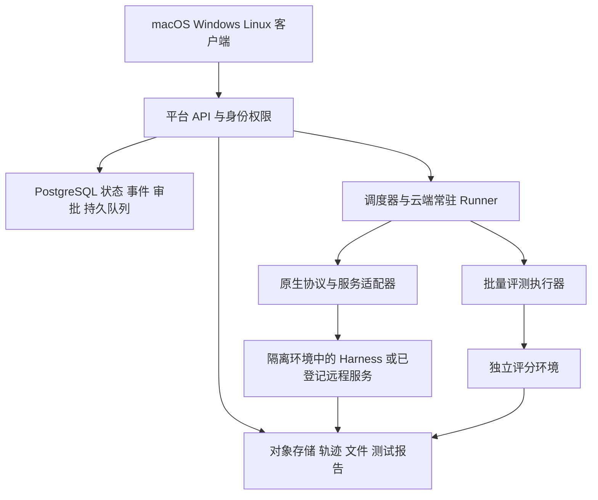

# 跨平台多 Harness 客户端与云端管理平台预研

日期：2026 年 10 月 27 日。目标已确认：同时支持团队自有云私有部署和面向外部客户的多租户 SaaS，客户端覆盖 macOS、Windows、Linux。OpenDesign 指 `nexu-io/open-design`。范围包含通用工作 Agent，编码是其中一个场景。

建议把产品定义为“多 Harness 的部署、会话和评测管理平台”，桌面客户端是入口。核心价值是让团队可靠地部署、使用、比较和升级不同运行时。统一聊天已有多个竞品；云端生命周期、权限与隔离、原生能力保留、可复现评测，更值得投入。

本轮核验了官方文档、源码、发布记录、许可证和部分 npm 发布物；尚未安装运行、调用模型或压测。下面的短名单是集成候选，不能视为已经完成生产认证。架构和上线门槛属于本项目建议。

# 现有产品与可复用部分

| 项目 | 与本产品的关系 | 借鉴或复用重点 | 需要保留的边界 |
| --- | --- | --- | --- |
| HarnessRouter CE | 最直接的统一后端候选 | 统一 API、原生 harness adapter、流、文件、会话、取消和契约测试 | Apache 2.0；社区版单登录、单容器、SQLite；部分适配器使用自动允许模式，审批需逐项验证 |
| Octop | 与目标高度相关的三端自托管工作台 | 多用户、专家工作区、模型配置、双向 ACP、跨实例协同 | MIT；外部 Agent 为委派模式；单进程及规划中的托管能力不能等同 SaaS 弹性执行池 |
| OpenHands Agent Canvas | 多运行环境与多 Agent 客户端竞品 | backend 注册、工作区、聊天、终端、文件和嵌入式界面 | 桌面仍 early preview；已发布 ACP 桥自动批准，人工审批需改造 |
| HAPI | 多机器原生 harness 远程控制参考 | Runner 与 Hub 分离、远程启动、审批和能力矩阵 | AGPL 3.0，源码复用需匹配产品的分发与服务模式 |
| AionUi | 三平台交互参考 | ACP/CLI 接入、文件预览、多会话、桌面与 WebUI | UI 与 AionCore 后端分仓；团队并行不等同实验评测 |
| Happy | 跨设备与团队体验参考 | 同步、桌面与移动端、会话协作 | 新 Desktop 的 Happy Agent 是自有 harness，不能当原版 Claude/Codex 的等价实验对象 |
| OpenDesign | 设计任务工作区及适配层参考 | runtime 探测、事件归一化、skills、产物预览 | 已有桌面及 Docker；主要是设计工作流，不能当作通用云调度平台直接套用 |

来源：[Octop](https://github.com/TencentCloud/Octop)、[Octop 三端发行](https://github.com/TencentCloud/Octop/releases/tag/v1.0.3b1)、[HarnessRouter](https://github.com/HarnessRouter/harnessrouter)、[OpenHands 架构](https://github.com/OpenHands/OpenHands/blob/311dc1be63758e51d61e43d6574d5c03c7a30688/docs/architecture.md)、[OpenHands 桌面预览](https://docs.openhands.dev/openhands/usage/agent-canvas/setup#desktop-app-preview-build)、[ACP 审批实现](https://github.com/OpenHands/software-agent-sdk/blob/v1.58.1/openhands-sdk/openhands/sdk/agent/acp_agent.py#L1606)、[HAPI](https://github.com/tiann/hapi)、[AionUi](https://github.com/iOfficeAI/AionUi)、[Happy Agent](https://github.com/slopus/happy-agent)、[OpenDesign 架构](https://github.com/nexu-io/open-design/blob/26d60298f8129e229a1c10aab4df7ca25b1e9ad3/docs/architecture.md)。

对复用的建议：先评估 HarnessRouter 的适配与协议代码，以及 AionUi/OpenHands 的界面模块。租户、资源授权、部署状态、实验身份和账单由自己的平台持有。首轮不用同时 fork 多个完整产品；以同一套验收任务比较复用成本，再确定采用哪些模块。

HarnessRouter CE 目前所有会话属于单一 owner，不提供 SaaS 多成员/组织工作区、费用账本、跨副本事件和弹性沙箱；`max_cost_usd` 也不受支持。每会话独立系统用户仍共享容器。部分 CLI 以 YOLO/full 等模式运行，逐工具暂停、审批和澄清必须按 Adapter 验证，不能默认由统一 API 完整提供。[CE 部署边界](https://github.com/HarnessRouter/harnessrouter/blob/main/docs/self-hosting-guide.md)、[Runner](https://github.com/HarnessRouter/harnessrouter/blob/main/runner/server.py)

HarnessRouter 的 UHP 是值得对照的开放协议，但当前为 draft，治理和实现来源仍需按版本考察，不能宣传成已经广泛采纳的行业统一标准。[UHP](https://github.com/HarnessRouter/harnessrouter/tree/main/protocol)

## Octop 与底层运行时

[Octop](https://github.com/TencentCloud/Octop) 升入重点直接竞品与私有部署复用候选：主仓 MIT，已有多用户工作台、专家工作区、模型配置、工具审批、双向 ACP 和跨实例协同，且 v1.0.3b1 已提供 macOS、Windows、Linux 发行物。桌面采用 Wails 壳并捆绑本地运行包，值得参考部署与升级方式。[发行页](https://github.com/TencentCloud/Octop/releases/tag/v1.0.3b1)、[桌面实现](https://github.com/TencentCloud/Octop/blob/890111b7879665840414ca28ab168b05b0db0921/desktop/README.md)

应区分完整应用 Octop 与底层 Octop Harness。前者提供工作台、用户与服务 API，后者是基于 deepagents/LangGraph 的运行时层。ACP 当前使用 stdio：入站将 Octop 专家提供给外部客户端，出站通过 acp_runner 委派外部 CLI。委派组合的行为与费用不能直接算成原生外部 Harness 的效果。[ACP 契约](https://github.com/TencentCloud/Octop/blob/890111b7879665840414ca28ab168b05b0db0921/docs/acp.md)、[Octop Harness](https://github.com/TencentCloud/octop-harness)

当前 API 有聊天订阅、显式取消、人工审批恢复和轨迹读取，控制面支持 SQLite 或 PostgreSQL，但整体仍是单进程。跨实例 Bridge 不等同弹性执行池；README 将 Managed Agents 与云边卸载列为规划项。多用户权限也不自动构成公开 SaaS 的执行隔离。优先验证 Octop 服务适配及界面复用，另验收原生 runner 控制、跨用户隔离、恢复与批量评测。[API](https://github.com/TencentCloud/Octop/blob/890111b7879665840414ca28ab168b05b0db0921/docs/api.md)、[架构](https://github.com/TencentCloud/Octop/blob/890111b7879665840414ca28ab168b05b0db0921/docs/architecture.md)、[路线图](https://github.com/TencentCloud/Octop/blob/890111b7879665840414ca28ab168b05b0db0921/README.md#-roadmap)

Octop Harness v1.0.5 包元数据仍标 Alpha，源码中的出站 ACP 会话映射和待审批等待状态保存在进程内，且部分原生事件转为文本或被忽略。不能用主 Agent checkpoint 承诺外部 CLI 会话无损恢复；若复用，应保留专用原生协议适配器，并按完整依赖版本验收。[包元数据](https://github.com/TencentCloud/octop-harness/blob/76cd38d7b8ffc66c28ba24ad60bbab206a95d3ac/pyproject.toml)、[ACP 会话实现](https://github.com/TencentCloud/octop-harness/blob/76cd38d7b8ffc66c28ba24ad60bbab206a95d3ac/src/octop_harness/acp/service.py)、[事件映射](https://github.com/TencentCloud/octop-harness/blob/76cd38d7b8ffc66c28ba24ad60bbab206a95d3ac/src/octop_harness/acp/client.py)

# 用户清单中影响决策的更正

清单中“协议”一列的 MIT、Apache 2.0 等实际是许可证，应与 ACP、JSON-RPC、HTTP、WebSocket 等通信协议分列。源码可见、可修改重建、可商业使用、可私有部署和可自由对外提供多租户服务，也应分别核验。

| 条目 | 核验结论 | 对本产品的影响 |
| --- | --- | --- |
| OpenClaw | 当前 MIT，具有 Gateway 控制协议，不只是 ACP 包装 | 可进入通用运行时优先候选 |
| CoPaw | 官方仓库已转 QwenPaw，当前 Apache 2.0；Hub 限互信内部团队 | 可以接入，不能直接以其 Hub 承担公开 SaaS 隔离 |
| Mastra | 当前核心 Apache 2.0，`ee/` 为企业许可 | 核心与企业认证等功能分开核算 |
| AG2 与 AutoGen | 是不同项目；AG2 当前 Apache 2.0；Microsoft AutoGen README 已给出归档与迁移声明 | 不合并成一个 MIT 产品；微软新项目考察 Agent Framework |
| Semantic Kernel | 官方推荐后继 Microsoft Agent Framework | 既有接入与新底座选型分开 |
| OpenHands | 原名 OpenDevin，与 SWE-agent 不同 | 修正产品身份与架构来源 |
| Letta | 旧 V1 server 已退休；当前活跃 runtime 为 Letta Code App Server | 使用当前 local backend 文档，避免沿用旧服务部署说明 |
| Pi | 已迁 `earendil-works/pi`，有完整 CLI 和 JSONL RPC | 不是纯 SDK，但网络服务层需要包装 |
| Dify | 修改版 Apache 2.0，公开多租户服务与前端标识有附加条件 | 不能默认作为可无条件商用的 SaaS 基础 |
| OpenWorkBuddy | 同名项目须区分；本次核验的 CatCatUncle 项目为独立社区实现和非商业许可 | 取得相应商业授权前不纳入默认商业部署目录 |
| 腾讯 agent-harness | 已确认可运行发布物和 MIT 式许可；完整可重建源仓与任意模型替换尚待补证 | 暂不视为已满足全部筛选条件 |

来源：[OpenClaw LICENSE](https://github.com/openclaw/openclaw/blob/a218de7ac2355fa962833cc8720fbdbdb4d131d2/LICENSE)、[QwenPaw](https://github.com/agentscope-ai/QwenPaw)、[QwenPaw Hub](https://github.com/agentscope-ai/QwenPaw/blob/v2.2.2.post1/website/public/docs/hub.en.md)、[Mastra LICENSE](https://github.com/mastra-ai/mastra/blob/main/LICENSE.md)、[AG2](https://github.com/ag2ai/ag2)、[AutoGen](https://github.com/microsoft/autogen)、[Semantic Kernel](https://github.com/microsoft/semantic-kernel)、[OpenHands 论文](https://arxiv.org/abs/2407.16741)、[Letta 迁移](https://github.com/letta-ai/letta)、[Pi 迁移](https://pi.dev/changelog/2026/5/7/pi-has-a-new-home)、[Dify LICENSE](https://github.com/langgenius/dify/blob/main/LICENSE)、[OpenWorkBuddy](https://github.com/CatCatUncle/openworkbuddy)、[腾讯发布元数据](https://registry.npmjs.org/@tencent-ai%2fagent-harness)。

“可部署 API 服务”还需要沿调用链检查。例如 TrueForge/OAO 自身可部署，并不自动证明其沙箱也可完整自托管。Daytona 官方旧仓库说明核心开发已转私有，旧版不再发行或维护；因此不能把使用它的项目统一列为完整开源执行栈。[Daytona 维护声明](https://github.com/daytonaio/daytona/blob/main/README.md)

# 首批运行时接入候选

先用不同架构的少数运行时验证接入边界，比同时支持大量名字更有价值。建议第一批研究 Hermes、OpenClaw、OpenCode，并加入 DSH 的版本锁定验证。DSH 在通过验收前标为预览兼容；Octop 单列为重点完整服务接入与产品复用验证对象。下面排序针对接入适配和场景覆盖，不是 Agent 效果排名。

| 候选 | 适合验证什么 | 接入依据 | 首要限制 |
| --- | --- | --- | --- |
| Hermes Agent | 通用工作、记忆、skills、长任务 | v0.22.5 有 runs、SSE、停止、审批、澄清、会话与能力发现 | API 与 CLI/IM 会话拥有权不同，不能混用 session ID 接管 |
| OpenClaw | 常驻助手、Gateway、多渠道和远程控制 | WS 控制协议、会话、事件、operator scopes、审批与恢复 | Gateway 属受信边界；公开多租户需要外层隔离 |
| OpenCode | 文件与代码任务、HTTP 服务基线 | Server/OpenAPI、SSE、会话、权限、取消 | 仍需配置鉴权、文件隔离及资源预算 |
| DeepSeek Harness | 插件化、Node、原生可配置运行时 | 官方 MIT，Web/headless/SDK/ACP、事件持久化、审批及模型配置 | 官方 developer preview，允许破坏性变更 |
| Octop Harness / Octop 服务 | 通用工作、记忆、工具、完整工作台接入 | 底层 deepagents/LangGraph；完整产品有 HTTP/WS、持久历史与审批入口 | 底层包元数据仍 Alpha；外部 ACP 委派的事件保真和重启恢复需单独验收 |
| TrueForge | 完整服务型 harness | MIT；HTTP/SSE、会话、hosted 拓扑和自定义模型 | 默认配置与沙箱自托管依赖须单独验收 |
| QwenPaw | 办公、文件、团队内部任务 | REST/SSE、持久会话、工具审批、Console | 内置 Hub 仍不面向不互信公共租户 |
| Letta App Server | 长期记忆与状态型 Agent | local backend、WS sync/abort/approval | 最后订阅者断线可能取消执行，需要常驻云控制器持有连接 |
| Pi | 可控 CLI 与扩展式运行时 | 长驻 JSONL RPC、会话树、resume、extensions | 需要自己的服务、鉴权、审批和进程管理层 |
| OAO | 服务架构与持久执行参考 | Apache 2.0、HTTP/SSE、worker、Postgres | 官方 early beta；任意自建模型端点未确认；部分治理与沙箱能力有限 |

来源：[Octop Harness](https://github.com/TencentCloud/octop-harness)、[Octop API](https://github.com/TencentCloud/Octop/blob/890111b7879665840414ca28ab168b05b0db0921/docs/api.md)、[Hermes API](https://github.com/NousResearch/hermes-agent/blob/v0.22.5/website/docs/user-guide/features/api-server.md)、[OpenClaw client](https://docs.openclaw.ai/gateway/clients)、[OpenCode Server](https://opencode.ai/docs/server/)、[DSH](https://github.com/deepseek-ai/deepseek-harness/blob/22ddee3792402c3e70ec5f86a63c3e3e895a2f60/README.md)、[TrueForge](https://github.com/truefoundry/trueforge/tree/cf786ee874f6d1b7901a34a2faa2c0798117a725)、[QwenPaw API](https://github.com/agentscope-ai/QwenPaw/blob/v2.2.2.post1/website/public/docs/api-tutorial.en.md)、[Letta lifecycle](https://docs.letta.com/self-hosting/app-server/protocol-lifecycle)、[Pi RPC](https://github.com/earendil-works/pi/blob/v1.4.0/packages/coding-agent/docs/rpc.md)、[OAO limitations](https://github.com/vectrix-ai/oao/blob/a0f6f658ee1ae0923dbd7fac6166206446137806/docs/reference/mvp-limitations.mdx)。

腾讯包单独保留为候选：`0.1.6` 发布物包含 supervisor、Resource 子进程、会话与 JSON-RPC，public transport 并非只有 UDS；UDS/Named Pipe 还涉及私有进程边界。但目前证据不足以承诺“完整源码可重建、任意 OpenAI 兼容端点可替换、完整 WorkBuddy 服务”。核验结果不等于认定它闭源。[npm 发布包](https://registry.npmjs.org/@tencent-ai%2fagent-harness)

Strands Harness、deepagents/LangGraph、Mastra、tRPC-Agent、CrewAI、AG2、Microsoft Agent Framework、Haystack 可以进入“用户应用运行包”类别。接入对象要是包含确定 Agent、工具、存储和服务入口的运行包，不能只拿框架名称进行效果比较。deepagents 的 MIT 库与 LangSmith Agent Server 的部署许可也不是同一件事。[Strands](https://github.com/strands-agents/harness-sdk)、[Deep Agents 生产说明](https://docs.langchain.com/oss/python/deepagents/going-to-production)、[LangSmith data plane 许可](https://docs.langchain.com/langsmith/data-plane#licensing)

Claude Agent SDK 等不符合本轮开放运行时优先范围，不作为基础依赖。未来若接商业 Agent，要单独处理认证授权。官方 OpenAI 文档仍对 app-server 的远程生产支持、内置认证用于商业托管以及 Sign in with ChatGPT 准入作出限制；这些限制不能由第三方开源客户端的实现替代。[Codex App Server](https://learn.chatgpt.com/docs/app-server)、[SIWC 准入](https://developers.openai.com/siwc/request-client-id)、[Claude Agent SDK](https://code.claude.com/docs/en/agent-sdk/overview)

# 产品应提供的主要工作流

## 部署和使用运行时

用户创建项目，选择云端执行目标和运行时版本，配置模型凭据、工具、skills、工作区与权限策略。平台完成部署与能力检查后，用户创建会话，查看工具执行，处理审批，获取文件和产物；关闭客户端后云端继续工作。

管理界面应展示运行时、Adapter、镜像版本、健康状态、能力、原生会话 ID、活动任务、费用和资源使用。升级要先跑兼容测试再切换，新旧版本的会话存储是否兼容需要显式声明；不能默认最新版本可以读取旧状态。

## 比较和选用运行时

用户选择任务集、候选组合、预算与重复次数，平台显示计划试验数量，再调度到独立环境执行。结果按任务横向比较成功率、时间、费用、工具与人工干预，并能打开原始轨迹、文件、测试报告和失败原因。表现合适的配置可以发布成项目预设，但评测结果必须保留其版本与适用任务范围。

这两种流程共用运行时目录、模型配置、工作区、凭据与事件格式。交互会话和批量试验使用不同的生命周期：前者需要连续上下文，后者默认从干净状态开始，避免记忆和文件污染对比结果。

# 推荐总体架构

以下为生产方案建议。私有版和 SaaS 共用领域模型、API、客户端与运行包；部署拓扑及信任边界按场景配置。

控制面只承担身份、授权、目录、配置、状态、调度和数据管理。任意代码、浏览器操作和工具执行放在独立执行面。Runner 在云端保持原生连接，桌面通过平台读写会话；不要让桌面的生命周期成为云任务的生命周期。

客户端共用一套 React/TypeScript 界面。桌面壳默认建议 Electron，主要考虑相同浏览器内核下的流式 UI、终端、文件预览和 SDK 集成；这是工程取舍，不是性能测量结论。Tauri 也是可选方案，适合团队有 Rust 能力并能承担 WebView 差异验证的情况。界面不得直接持有跨租户的长期运行时管理员凭据，原生 IPC 只暴露必要能力。[Electron 安全建议](https://www.electronjs.org/docs/latest/tutorial/security)、[Tauri capabilities](https://tauri.app/security/capabilities/)

发布从第一天覆盖三端签名与安装验证。macOS 签名和 notarization、Windows 签名、Linux 安装与升级策略都进入正式交付；Electron 内置自动更新没有 Linux 支持，需要明确选择发行包管理或其他更新实现。[Electron autoUpdater](https://www.electronjs.org/docs/latest/api/auto-updater/)、[Tauri distribution](https://tauri.app/distribute/)

后端建议 TypeScript 模块化单体，Runner 独立进程或机器部署，Python 评测执行器通过版本化 API/任务清单集成。PostgreSQL 存业务状态与队列，对象存储放大日志和产物，使用现成 OIDC 和 Secret/KMS。可以评估 pg-boss 等成熟 PostgreSQL 队列，避免一开始增加多套基础设施。队列的至少一次交付不等于工具副作用只执行一次。[pg-boss 官方语义](https://pgboss.io/introduction)

Kubernetes 是执行池与客户部署选项，Temporal 是复杂长流程的备选，两者不构成生产可用的先决条件。是否采用，要由实际并发、跨节点调度、可用性目标和运维能力决定。

# 三种接入类型与协议边界

| 接入类型 | 例子 | 平台负责的工作 |
| --- | --- | --- |
| 已存在的服务 | OpenClaw Gateway、Hermes API、OpenCode Server、Letta App Server | 服务身份、能力发现、会话映射、事件持久化、审批与取消、授权代理 |
| 受平台管理的进程 | Pi RPC、DSH profile、ACP agent | 安装与版本、启动/停止、工作区、环境变量、存储、原生连接、资源隔离 |
| 应用运行包 | 固定配置的 deepagents、Strands、tRPC-Agent、CrewAI 应用 | 可重建镜像、服务入口、Agent 定义、工具与存储配置、契约测试 |

外层保留自己的稳定管理 API；底层优先使用能保留能力的原生接口，ACP 作为一种适配方式。MCP 主要解决工具与资源接入，A2A 主要解决 Agent 间协作，OTel 负责遥测，均不能直接替代部署、会话、权限和恢复。ACP 的网络 transport 还存在版本与草案边界，不能据“支持 ACP”推导出任意云端连接都已经可用。[ACP transports](https://agentclientprotocol.com/protocol/v1/transports)、[MCP architecture](https://modelcontextprotocol.io/docs/learn/architecture)

能力至少逐项记录：新会话、原生续接、会话分支、历史读取、流式文本、工具事件、审批、澄清问题、取消、文件、产物、模型切换、并发限制、断线恢复和用量。未知与不支持应显示为对应状态，不能填成“已支持”。

同一产品会话可以包含多个运行时的分支，但原生状态按运行时保存。换 harness 时显式传递任务、摘要、工作区快照和文件，创建新的原生会话；不能承诺把 KV cache、隐藏上下文、工具状态或长期记忆无损迁移。

# 私有部署和 SaaS 的生产要求

| 要求 | 团队私有部署 | 对外多租户 SaaS |
| --- | --- | --- |
| 运行位置 | 客户云账号或内网，平台运行包可独立安装 | 平台运营的控制面和执行池，可扩展客户自有 Runner |
| 身份 | 企业 OIDC，组织、项目与成员权限 | 同样的权限模型，加组织间强制隔离和滥用控制 |
| 执行边界 | 按实际信任域部署独立 VM/执行池 | 不互信租户使用 VM/microVM 或经验证的强化沙箱边界 |
| 持久数据 | 客户自己的数据库、对象存储、密钥与备份 | 每资源校验 tenant/project，存储路径和下载授权隔离 |
| 生命周期 | 离线安装、升级、备份和恢复文档 | 配额、计量、预算、执行对账、容量调度和孤儿资源回收 |

不把共享容器中的不同目录或 Linux 用户当作互不信任客户的完整边界。Agent 无权访问宿主 Docker socket、平台数据库、云管理身份或其他组织的凭据；运行时自己的 Hub 也不自动承担平台租户隔离。Firecracker 是 microVM VMM，gVisor 是强化隔离层，选择后仍需测试环境兼容与部署条件。[Docker security](https://docs.docker.com/engine/security/)、[Firecracker](https://github.com/firecracker-microvm/firecracker)、[gVisor](https://gvisor.dev/docs/)

会话/试验使用独立文件系统与 HOME/profile。长期记忆需要按用户、项目与实验策略分区；批量实验冻结初始记忆，或显式比较学习过程。Secret 保存为引用并按运行授权获取；日志脱敏不能替代最小权限和限制出网。对模型、Git、包仓库和外部工具分别定义出口规则。

费用控制按渠道定义。由平台代理的模型请求，在提交前预留预算、限制单次最大消耗和并发，在接近阈值时停止新调用，并保留在途请求及延迟结算的缓冲。直接 BYOK、不可代理或不暴露可靠用量的运行时，只能提供对应的估算、时间/步数限制或上游配额控制，不能承诺精确费用硬封顶。界面明确区分实测、估算和不可观测费用。

运行状态以云端持久记录为准。命令使用幂等键，事件具有唯一 ID 和顺序号，客户端重连按游标补取。Runner 租约丢失先检查真实进程与沙箱，再接管或终止；状态不明时标记待核对，避免再启动一个 Agent 同时修改工作区。取消先请求原生停止，再确认进程与执行环境终止，不能在请求发出时就显示成功。

原始事件、统一 UI 事件和评测交换格式各有用途。原始事件保留诊断证据，统一事件提供产品体验，ATIF 等格式提供评测互操作。能导出轨迹不代表能从轨迹恢复原生会话。[Harbor ATIF](https://docs.harborframework.com/agents/atif)

# 批量测试的正确设计

首先分开两个实验问题：

1. **比较运行时。** 尽量固定模型、任务、环境、预算和权限，在共同支持的范围内改变 harness；保留其原生工具、上下文与恢复机制，并记录无法等价的差异。
2. **比较用户实际方案。** 比较“模型、harness、skills、工具和配置”的组合，允许各自适配，但结论只归属于这个组合。

每个试验需要固定任务与数据版本、输入文件 hash、代码 commit、镜像 digest、harness/Adapter/Gateway 版本、网关注入指令与工具转换、模型映射和默认配置、实际模型 ID/endpoint/参数、skills/MCP/工具、记忆初始状态、网络策略、审批策略、资源、预算、超时及评分器版本。网关有额外改造时，结果标记为该组合，不能直接归因为原生 Harness 差异。可复现指输入、配置、环境、过程和产物可追溯并能重跑，不承诺模型输出逐字一致。

示例：20 个任务、3 个运行时、每个组合重复 3 次，产生 180 个计划试验。模型只在共同支持配置中固定；不兼容项显示不兼容，不偷偷换模型。预算同时包含模型、运行环境、评分模型和重试成本。

结果至少显示：客观任务完成、文件/补丁质量、耗时分段、模型与环境费用、人工干预、任务失败、基础设施失败和多次运行波动。并列展示“有效评分中的成功率”和“全部计划试验的交付率”，明确分母和排除项；不能静默丢掉限流/鉴权错误来提高成功率。

编码任务用干净环境执行测试；办公任务检查文件可打开、结构与内容、公式、页面和格式等条件；浏览器任务检查目标业务状态；长期记忆任务验证跨会话召回与数据隔离。LLM Judge 用于难以程序化的质量维度，保存 rubric 和模型版本并抽样人审，不能覆盖客观失败。独立评分环境避免 Agent 修改评分规则或奖励文件。[Harbor separate verifier](https://docs.harborframework.com/tasks/separate-verifier)

## 评测工具的选择

| 类型 | 推荐研究对象 | 使用边界 |
| --- | --- | --- |
| 主执行器 | Harbor、AgentCompass | 用同一批任务比较后先选一个；不同时维护两套主调度语义 |
| 跨 harness 方法与任务 | Harness-Bench、PawBench | 保留 native harness；分别核实数据许可、评分与版本 |
| 编码/终端外部参照 | 明确版本的 Terminal-Bench、SWE-bench | 不代替自己的目标客户任务 |
| 浏览器/桌面/业务环境 | WebArena、OSWorld、τ-bench | 作为任务环境插件，不当通用云会话 runtime |
| 优化与多 Agent 研究 | Harness²、MASEval | 优化成本和测试时自适应单列，防止测试集信息泄漏 |
| 观测和回归 | OpenLIT、Kensa、ProofAgent、可选 Langfuse | 采集实际暴露的事件与评分，不替代控制面 |

来源：[Harbor](https://docs.harborframework.com/)、[AgentCompass](https://github.com/open-compass/AgentCompass)、[Harness-Bench](https://www.harness-bench.ai/)、[PawBench](https://github.com/agentscope-ai/PawBench)、[Terminal-Bench](https://www.tbench.ai/benchmarks)、[SWE-bench](https://www.swebench.com/SWE-bench/guides/evaluation/)、[WebArena](https://github.com/web-arena-x/webarena)、[OSWorld](https://github.com/xlang-ai/OSWorld)、[τ-bench](https://github.com/sierra-research/tau-bench)、[Harness²](https://github.com/google-research/harness2)、[MASEval](https://github.com/maseval/MASEval)、[OpenLIT](https://github.com/openlit/openlit)、[Kensa](https://github.com/kensa-sh/kensa)、[ProofAgent](https://github.com/ProofAgent-ai/proofagent-harness)。

本轮需要保留的限制：Harness-Bench 官网与论文当前任务数量不同，且根目录尚未找到明确 LICENSE，先借鉴方法；WorkBuddy-Bench 采用含地域条款的自定义许可，不能按标准宽松许可直接内置。Arnes、ClawBench 等名字有多个独立项目，接入前需要固定具体仓库。OpenLIT 需要受支持的 instrumentation/hook/事件集成，不能自动观察任意黑盒运行时的全部内部状态。[Harness-Bench 仓库](https://github.com/Qihoo360/harness-bench)、[WorkBuddy-Bench LICENSE](https://github.com/Tencent/workbuddy-bench/blob/main/LICENSE)

# 首版正式范围和验收条件

首版交付应是可持续使用的完整闭环：三端客户端、项目与权限、运行时部署与版本管理、统一会话和审批、文件产物、预算与费用、少量运行时的完整兼容、一套批量实验与报告，以及私有版和 SaaS 部署配置。暂缓无损跨运行时迁移、自动选最优 harness、大规模插件市场，以及全部远端操作系统支持。

客户端跨三平台不等于执行环境也跨三平台。首版可以把正式执行环境限定为云端 Linux；依赖 Windows Office 或 macOS 工具的任务，后续接专用 Windows/macOS Runner，并单独标明授权、镜像和评分条件。

建议以以下条件作为发布门槛：

- 每个正式支持的运行时，通过所承诺的创建、事件、取消、会话连续性及产物核心流程；审批、澄清、分支等按真实能力分别验收。需要人工批准的工作流遇到不支持的 Adapter 时拒绝启动，不静默自动放行。
- 退出桌面、断网和重新登录后，云任务仍按策略继续，状态、日志与待审批动作可恢复。
- 重启 API、杀死 Worker、模型限流、沙箱超时和网络不确定性不会导致工作区双重执行或已接受任务静默丢失。
- 两个互不信任组织不能读取对方会话、文件、下载链接、凭据、记忆或执行身份。
- 并发、时长和资源限制有效；费用控制符合该模型渠道声明的精度、停止阈值与在途消耗边界；孤儿进程/沙箱可核对和回收。
- 同一实验 Manifest 可重跑，首次与重试结果、原始轨迹、评分和累计费用可追溯。
- 私有部署有完整依赖清单、镜像来源、备份恢复、升级迁移和回退说明；离线部署不隐含必须连接外部控制面。
- 三端安装签名、升级、回退和崩溃恢复经过真实系统验证。

技术验证优先解决以下问题：HarnessRouter 适配代码能否复用并移到隔离执行池；Hermes/OpenClaw/OpenCode/DSH 能否保留完整原生控制；Octop 的完整服务和双向 ACP 能否保留所需会话、审批与恢复语义；Harbor 与 AgentCompass 哪个更适合通用任务；至少两个可替换模型端点能否完成含工具的闭环任务。依据这些结果再锁定完整 PRD、领域契约、部署方案和开发工作量。

# 详细核验记录

本地研究目录另存原始核验笔记，包含各项目固定 commit/package 快照和更多引用：`opendesign-analysis.md`、`product-landscape.md`、`harnessrouter.md`、`octop.md`、`octop-harness.md`、`runtime-shortlist.md`、`persistent-agent-runtimes.md`、`framework-catalog-audit.md`、`harness-protocols.md`、`evaluation-cloud.md`、`evaluation-catalog-audit.md`。
